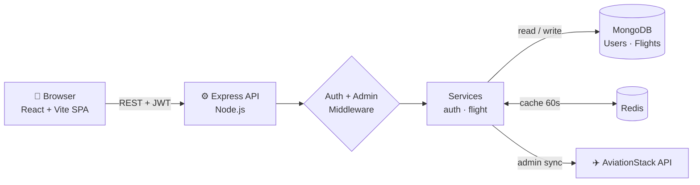

# ✈️ AeroOps — Flight Operations Management Platform

A full-stack web platform for viewing and managing airline flight schedules. Travelers browse a live departure board; operations admins add, edit, delete and sync flights from a single dashboard. Built with a **React + Vite** frontend and a **Node.js / Express** REST API backed by **MongoDB** and a **Redis** cache.


## ✨ Features

- **JWT authentication** — signup / login, bcrypt-hashed passwords, 1-day tokens
- **Role-based access** — `user` can view flights; `admin` can create, update, delete and sync
- **Live flight data** — one-click sync from the [AviationStack](https://aviationstack.com/) API
- **Redis caching** — flight list cached for 60s, auto-invalidated on every change, with graceful fallback to MongoDB if Redis is down
- **Search & filter** — by airline, route, flight number and status
- **Admin dashboard** — metrics for total, scheduled and active flights
- **Deploy-ready** — Dockerfile for the API, SPA rewrites for Vercel

## 🏗️ Architecture



**Request flow:** `Route → Auth middleware (JWT) → Admin middleware (write routes) → Controller → Service → MongoDB / Redis`

## 🧰 Tech Stack

| Layer | Technology |
|---|---|
| Frontend | React 18, Vite 6, React Router 6, Lucide icons |
| Backend | Node.js 22, Express 5 |
| Database | MongoDB with Mongoose |
| Cache | Redis (ioredis) |
| Auth | JSON Web Tokens, bcrypt |
| External API | AviationStack |
| DevOps | Docker, Vercel (frontend) |

## 📁 Project Structure

```
.
├── backend/
│   ├── server.js              # Entry point: connects DB, starts server
│   ├── Dockerfile
│   ├── scripts/
│   │   └── seedDemoFlights.js # Seeds 5 demo flights
│   └── src/
│       ├── app.js             # Express app, CORS, routes
│       ├── config/            # MongoDB + Redis connections
│       ├── controllers/       # Request handlers (auth, flight)
│       ├── middlewares/       # JWT auth, admin guard, error handler
│       ├── models/            # User & Flight schemas
│       ├── routes/            # /api/auth, /api/flights
│       └── services/          # Business logic + caching
└── frontend/
    ├── vercel.json            # SPA rewrites
    ├── vite.config.js         # Dev proxy → :3000
    └── src/
        ├── App.jsx            # Routes, pages, admin dashboard
        ├── api.js             # API client
        └── styles.css
```

## 🔌 API Endpoints

| Method | Endpoint | Access | Description |
|---|---|---|---|
| POST | `/api/auth/signup` | Public | Create an account |
| POST | `/api/auth/login` | Public | Get a JWT |
| GET | `/api/flights` | User | List all flights (cached) |
| GET | `/api/flights/:id` | User | Get one flight |
| POST | `/api/flights` | Admin | Add a flight |
| PATCH | `/api/flights/:id` | Admin | Update a flight |
| DELETE | `/api/flights/:id` | Admin | Delete a flight |
| POST | `/api/flights/sync` | Admin | Sync live data from AviationStack |

Protected routes expect `Authorization: Bearer <token>`.

## 🚀 Getting Started

**Prerequisites:** Node.js 22+, a MongoDB database, and Redis (optional — the API falls back to MongoDB without it).

```bash
# 1. Backend
cd backend
npm install
# create backend/.env (see below)
npm run seed:demo      # optional: load demo flights
npm run dev            # http://localhost:3000

# 2. Frontend (new terminal)
cd frontend
npm install
npm run dev            # http://localhost:5173
```

### Environment variables

`backend/.env`

| Variable | Purpose |
|---|---|
| `MONGO_URL` | MongoDB connection string |
| `JWT_SECRET` | Secret used to sign tokens |
| `REDIS_URL` | Redis URL (default `redis://127.0.0.1:6379`) |
| `AVIATION_API_KEY` | AviationStack key, needed only for sync |
| `ADMIN_EMAIL` | Optional sign-in email granted the admin role after valid login (set only for a trusted existing account) |
| `CORS_ORIGINS` | Comma-separated allowed origins (required in production) |
| `PORT` | Server port (default `3000`) |

`frontend` — set `VITE_API_BASE_URL` to the deployed API URL in production (defaults to `/api`, proxied to the backend in dev).

> **Admin access:** new accounts get the `user` role. In production, set `ADMIN_EMAIL` in Render to a trusted existing account's sign-in email. After that account signs in with a valid password, it receives the `admin` role and can sync live flights. Do not set this to an email that has not been registered by the account owner.

### Docker

```bash
cd backend
docker build -t aeroops-api .
docker run -p 3000:3000 --env-file .env aeroops-api
```

### Run everything locally with Docker Compose

```bash
docker compose up --build      # MongoDB + Redis + API on http://localhost:3000
cd frontend && npm install && npm run dev
```

## ☁️ Production deployment

| Part | Where | Notes |
|---|---|---|
| API | **Render** web service (Docker, root dir `backend`) | Auto-deploys on push to `main` |
| Database | **MongoDB Atlas** | Atlas → Network Access must allow Render (`0.0.0.0/0`), as Render has no fixed IP on the free plan |
| Cache | **Upstash Redis** | `REDIS_URL` = `rediss://default:<password>@<host>:6379` (no quotes) |
| Frontend | **Vercel** (root dir `frontend`) | Set `VITE_API_BASE_URL` = `https://<render-service>.onrender.com/api` |

Render environment: `MONGO_URL`, `JWT_SECRET`, `REDIS_URL`, `CORS_ORIGINS` (the Vercel URL, e.g. `https://your-app.vercel.app`), optional `AVIATION_API_KEY`. See `backend/.env.example`.

## 🗺️ Roadmap

- Flight booking and seat selection
- Automated tests and CI pipeline
- Scheduled background sync of live flight data

## 👤 Author

**AkTech3628** — [GitHub](https://github.com/AkTech3628)
